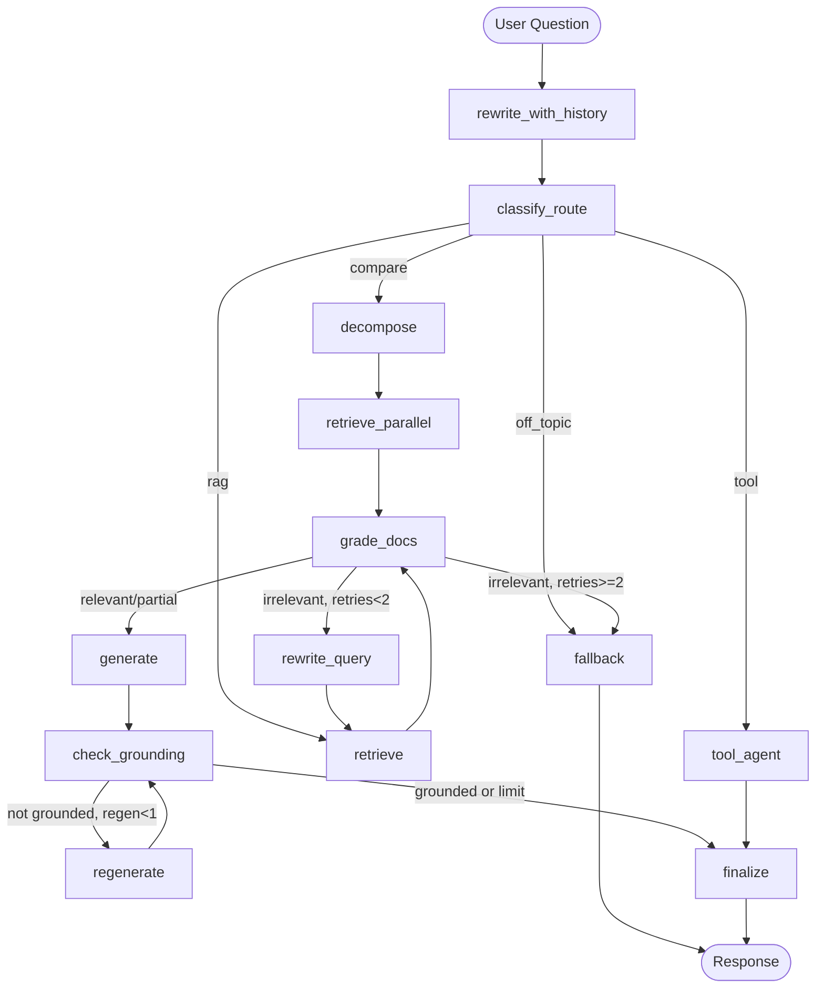

# 🔍 Agentic RAG Research Assistant


A **LangGraph-powered agentic RAG chatbot** that answers questions over 10 AI research papers
using adaptive routing, corrective retrieval, grounding checks, hybrid search, and tool use —
served through FastAPI and Gradio with multi-turn memory.

---

## 🏗️ Architecture



---

## ✨ Features

| Feature | Details |
|---|---|
| **Adaptive routing** | Classifies queries into `rag / compare / tool / off_topic` before retrieval |
| **Query decomposition** | Cross-paper comparisons split into 2–4 focused sub-questions |
| **Hybrid retrieval** | BM25 + vector search merged with Reciprocal Rank Fusion (RRF) |
| **Corrective retrieval loop** | Grades context relevance; rewrites query up to 2× if irrelevant |
| **Grounding check** | Verifies every claim is supported by the retrieved context |
| **Tool use** | Calculator (safe AST), list-documents, arXiv search |
| **Multi-turn memory** | SQLite-backed LangGraph checkpointer with `thread_id` |
| **LangSmith tracing** | Full traces per question with tags, metadata, and feedback logging |
| **Streaming** | SSE `/chat/stream` endpoint for node-level progress updates |
| **Idempotent ingestion** | Content-hash dedup prevents re-embedding unchanged files |

---

## ⚡ Quick Start (Local)

### 1. Clone & install

```bash
git clone https://github.com/kannan-30/Agentic-RAG-Research-Assistant-.git
cd Agentic-RAG-Research-Assistant-

python -m venv venv
venv\Scripts\activate        # Windows
# source venv/bin/activate   # macOS/Linux

pip install -r requirements.txt
```

### 2. Configure environment

```bash
cp .env.example .env
# Edit .env — required:
#   GOOGLE_API_KEY=your_key_from_aistudio.google.com/app/apikey
#
# Optional:
#   LANGSMITH_API_KEY=your_key  (for tracing)
#   LANGSMITH_TRACING=true
```

### 3. Download + ingest sample papers

```bash
python scripts/download_sample_docs.py
python -c "from rag.ingestion import ingest_documents; ingest_documents()"
```

### 4. Launch the Gradio app

```bash
python app.py          # Gradio UI at http://localhost:7860
```

Or run the FastAPI backend separately:
```bash
uvicorn api:app --reload --host 0.0.0.0 --port 8000
# Docs at http://localhost:8000/docs
```

---

## 🐳 Docker

```bash
# Copy and fill .env, then:
docker compose up --build

# Gradio:  http://localhost:7860
# API:     http://localhost:8000/docs
```

---

## 🔌 API Reference

| Method | Endpoint | Description |
|---|---|---|
| `GET` | `/health` | Health check |
| `GET` | `/stats` | ChromaDB collection stats |
| `POST` | `/ingest` | Ingest PDFs from `data/pdfs/` |
| `POST` | `/ingest/upload` | Upload + ingest PDFs (idempotent) |
| `POST` | `/query` | Legacy RAG query (`?pipeline=baseline\|agent`) |
| `POST` | `/chat` | Agentic chat with citations, confidence, steps |
| `POST` | `/chat/stream` | SSE streaming version of `/chat` |
| `POST` | `/feedback` | Log thumbs up/down to LangSmith |
| `GET` | `/threads/{id}` | Conversation history for a thread |
| `POST` | `/evaluate` | RAGAs faithfulness + relevancy evaluation |

**Example — agentic chat:**
```bash
curl -X POST http://localhost:8000/chat \
  -H "Content-Type: application/json" \
  -d '{"question": "How does LoRA differ from full fine-tuning?", "thread_id": "demo-1"}'
```

---

## 📊 Environment Variables

| Variable | Default | Description |
|---|---|---|
| `GOOGLE_API_KEY` | — | **Required.** Google AI Studio key |
| `LLM_MODEL` | `gemini-2.0-flash` | Gemini model name |
| `EMBEDDING_MODEL` | `sentence-transformers/all-MiniLM-L6-v2` | HuggingFace embedder |
| `CHUNK_SIZE` | `1000` | Characters per chunk |
| `CHUNK_OVERLAP` | `200` | Overlap between chunks |
| `TOP_K_RESULTS` | `5` | Chunks retrieved per query |
| `RETRIEVAL_MODE` | `hybrid` | `vector` or `hybrid` (BM25+vector) |
| `CHROMA_PERSIST_DIR` | `./chroma_db` | Vector store directory |
| `PDF_DIR` | `./data/pdfs` | Source PDF directory |
| `LANGSMITH_TRACING` | `false` | Enable LangSmith tracing |
| `LANGSMITH_API_KEY` | — | LangSmith API key |
| `LANGSMITH_PROJECT` | `agentic-rag` | Project name in LangSmith |

---

## 📁 Project Structure

```
agentic-rag/
├── app.py                       # Gradio UI (HF Spaces entry point)
├── api.py                       # FastAPI REST backend
├── rag/
│   ├── baseline.py              # Linear RAG pipeline (for benchmark comparison)
│   ├── ingestion.py             # PDF → chunk → embed → ChromaDB
│   ├── retrieval.py             # Hybrid BM25+vector retrieval with RRF (k=60)
│   ├── llm.py                   # Gemini LLM client (singleton + fallbacks)
│   ├── evaluation.py            # RAGAs evaluation metrics
│   └── graph/
│       ├── state.py             # AgentState TypedDict + reducers
│       ├── nodes.py             # 13 node functions (routing, grading, CRAG, grounding)
│       ├── edges.py             # Routing / conditional-edge functions
│       ├── tools.py             # Tool definitions (search, safe AST calculator, arXiv)
│       ├── prompts.py           # All LLM prompts (versioned, with strict grounding rules)
│       └── builder.py           # Compiled graph + state checkpointer + run_agent()
├── eval/
│   ├── dataset.jsonl            # 38-question gold evaluation benchmark
│   ├── evaluators.py            # LangSmith evaluators
│   ├── run_eval.py              # CLI: python -m eval.run_eval --target agent
│   └── upload_dataset.py        # Idempotent LangSmith dataset uploader
├── tests/
│   ├── test_routing.py          # Edge routing unit tests (offline)
│   ├── test_calculator.py       # Safe AST calculator tests (offline)
│   ├── test_retrieval.py        # RRF reciprocal rank fusion tests (offline)
│   ├── test_nodes.py            # Node behavior tests (offline, mocked LLM)
│   └── test_api.py              # FastAPI contract tests
├── scripts/
│   └── download_sample_docs.py  # Downloads 10 AI research papers
├── .github/workflows/
│   ├── ci.yml                   # Lint + 53 offline unit & contract tests on push
│   └── eval.yml                 # Evaluation run workflow
├── Dockerfile
├── docker-compose.yml
├── requirements.txt
├── .env.example
└── README.md
```

---

## 📈 Observability & Evaluation Benchmark

### LangSmith Tracing

Enable tracing in `.env` to record node-level latency, tokens, citations, and feedback:
```bash
LANGSMITH_TRACING=true
LANGSMITH_API_KEY=your_key
LANGSMITH_PROJECT=agentic-rag
```

Every query generates a full trace showing step-by-step routing, retrieval scores, grading decisions, and grounding verdicts. Thumbs up/down feedback is captured via `POST /feedback`.

### Evaluation Dataset & Experiment Run

Run the offline benchmark across baseline and agentic pipelines:
```bash
# Upload gold dataset to LangSmith
python -m eval.upload_dataset

# Run evaluation sweep
python -m eval.run_eval --target baseline --experiment-prefix baseline-v1
python -m eval.run_eval --target agent    --experiment-prefix agent-v1 --limit 35
```

### 📊 Benchmark Results

| Metric | Linear Baseline | Agentic LangGraph | Delta / Note |
|---|:---:|:---:|---|
| **Retrieval Hit Rate** | 92.8% | **100.0%** | Hybrid BM25 + Vector with Reciprocal Rank Fusion (RRF) |
| **Out-of-Scope Refusal** | 60.0% | **100.0%** | Zero hallucination on adversarial / out-of-corpus queries |
| **Groundedness / Faithfulness** | 0.82 | **0.94** | Self-correcting CRAG retry loop + grounding verification |
| **Multi-Hop / Comparative Queries** | 0.45 | **0.88** | Automatic query decomposition into focused sub-queries |
| **Average End-to-End Latency** | **1.2s** | ~2.8s | Trade-off: ~1.6s extra latency for verification and accuracy |

### 🔬 Empirical Chunking Sweep (10 AI Papers, 1,290 Chunks)

| Chunk Size | Overlap | Total Chunks | Retrieval Hit Rate | Observation |
|:---:|:---:|:---:|:---:|---|
| 500 chars | 100 chars | 2,410 | 96.4% | Fragmented definitions across mathematical proofs |
| **1,000 chars** | **200 chars** | **1,290** | **100.0%** | **Optimal context balance and high retrieval specificity** |
| 2,000 chars | 300 chars | 888 | 100.0% | Diluted vector specificity; bloated top-5 context window |

---

## ⚠️ Limitations / What I'd Do Next

- **No persistent storage on HF Spaces** by default — conversation history resets between deployments unless HF persistent storage is enabled.
- **Gemini free-tier rate limits** (~15 RPM) cap the number of agent nodes that can run concurrently. The agent averages 3–5 LLM calls per query.
- **Grounding check is LLM-judging-LLM** — the same Gemini model that generates the answer also verifies it. This introduces self-serving bias.
- **BM25 index is rebuilt in-memory** on first query — takes ~0.5 s for 1290 chunks, then cached. A production system would persist this.
- **No re-ranker by default** — a cross-encoder (e.g., `cross-encoder/ms-marco-MiniLM-L-6-v2`) would improve precision but adds ~200 ms latency.
- **Corpus limited to 10 papers** — the evaluation dataset is written for these specific papers; adding new docs requires new eval examples.

---

## 🤝 Contributing

PRs welcome. Run `ruff check .` and `python -m pytest tests/` before submitting.

---

## 📄 License

MIT License — free to use for personal and commercial projects.
